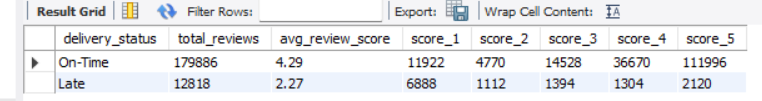
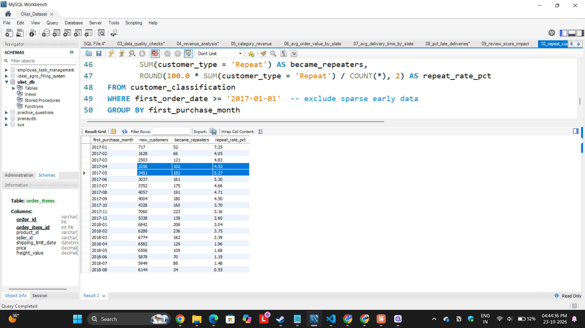
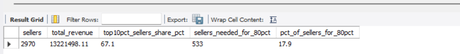
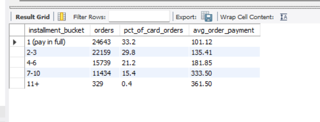
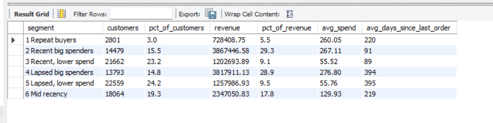

# Olist E-commerce SQL Analysis

MySQL analysis of ~100K orders from a Brazilian online marketplace (2016-2018).

## Business problem
Leadership wants to understand growth, delivery performance and customer
loyalty. This project answers 10 business questions using SQL.

## Dataset
[Brazilian E-Commerce Public Dataset by Olist (Kaggle)](https://www.kaggle.com/datasets/olistbr/brazilian-ecommerce)

9 source files: orders, order items, payments, reviews, customers, products,
sellers, geolocation and category translation (geolocation is not used here).

## Business questions
1. What is the monthly revenue and order trend, with month-over-month growth?
2. Which product categories generate the most revenue?
3. What is the average order value by customer state?
4. Which states have the slowest delivery times?
5. What percentage of orders arrive late?
6. How much do late deliveries lower review scores?
7. What is the repeat-customer rate?
8. How concentrated is revenue among sellers (the 80/20 question)?
9. How do payment types and installments relate to order value?
10. Who are the best customers (RFM segmentation)?

## Tools
MySQL 8, CTEs, window functions, data quality checks

## Key findings

### Q1. Monthly revenue and growth

1. Delivered orders generated **R$13.22M** in revenue between Sep 2016 and Aug 2018.
2. Revenue peaked in **Nov 2017 at R$987,765** (+52.4% vs Oct 2017, Black Friday),
   with 7,289 orders, the most of any month.
3. **Jan-Aug 2018 revenue was R$7.22M, about 2.4x the same months of 2017**
   (R$2.99M), a rise of roughly 141%.
4. Growth levelled off in 2018: after January, monthly revenue stayed between
   R$826K and R$978K.

_Note: Sep-Dec 2016 has almost no data and Nov 2016 has no delivered orders, so
growth percentages for those early months (and Jan 2017) are not meaningful._

### Q2. Top product categories by revenue

1. **health_beauty** is the top category with R$1.23M (9.3% of revenue), followed
   by **watches_gifts** (R$1.17M, 8.8%) and **bed_bath_table** (R$1.02M, 7.7%).
2. The top 10 categories generate **62.4%** of delivered revenue (R$8.25M of
   R$13.22M). The top 3 alone bring in 25.9%.
3. Order volume and revenue rank differently: bed_bath_table has the most orders
   (9,272) but ranks third, while watches_gifts ranks second with only 5,495
   orders because its revenue per order is about R$212, against about R$110 for
   bed_bath_table.

_Revenue = item price of delivered orders, freight excluded._

### Q3. Average order value by customer state

1. The overall average order value across all delivered orders is **R$137.04**,
   based on 96,478 orders generating R$13.22M in revenue.
2. **Para?ba (PB)** has the highest average order value at **R$217.77** (517 orders),
   followed by Alagoas (AL) at R$198.63 and Rond?nia (RO) at R$187.99.
3. The largest markets ? **S?o Paulo (SP), Minas Gerais (MG), and Rio de Janeiro (RJ)**
   ? have below-average order values (roughly R$130?143), suggesting customers in
   these states buy more frequently but in smaller baskets.
4. Several northern states (AP, AC, RR) show inflated averages due to very small
   sample sizes (fewer than 100 orders each); these should be interpreted cautiously.

_AOV = SUM(item price) per delivered order, averaged by customer state.
Freight excluded. Small-sample states flagged._

### Q4. Average delivery time by customer state

1. The national average delivery time is **12.50 days** across 96,470 delivered orders.
2. **S?o Paulo (SP)** is the fastest state at **8.70 days** average, handling 42% of all
   delivered orders (40,494). Paran? (PR) and Minas Gerais (MG) follow at ~12 days.
3. Remote northern states face significantly longer waits: **Roraima (RR)** averages
   **29.34 days**, Amap? (AP) 27.18 days, and Amazonas (AM) 26.36 days ? roughly
   3x slower than S?o Paulo.
4. Extreme outliers exist: several states show maximum delivery times of 170?196 days,
   suggesting stuck or lost packages that inflate averages. Northern states also have
   small sample sizes (<150 orders), so their rankings should be interpreted cautiously.

_Delivery time = DATEDIFF(order_delivered_customer_date, order_purchase_timestamp).
Only delivered orders with non-NULL delivery dates included._

### Q5. Percentage of late deliveries

1. Only **6.77%** of delivered orders arrive late (6,534 out of 96,470), but when
   deliveries are late, customers wait an average of **10.62 extra days**.
2. **Alagoas (AL)** has the highest late rate at **21.41%**, followed by Maranh?o
   (MA) at 17.43% ? both Northeast states with underdeveloped logistics. In contrast,
   S?o Paulo (SP) maintains just **4.49%** late rate despite handling 42% of all orders.
3. By category, **furniture and mattresses** show the highest late rates (13.51%),
   while high-volume categories like health/beauty (7.51%) and bed/bath/table (7.43%)
   perform near the national average, indicating mature logistics for core product lines.
4. Remote northern states (AM, RO, AP) paradoxically have the *lowest* late rates
   (2.76?2.99%) despite longest delivery times (Q4), suggesting their delays are
   predictable and baked into estimates rather than unexpected failures.

_Late = order_delivered_customer_date > order_estimated_delivery_date.
Only delivered orders with valid estimated dates included._

### Q6. Impact of late deliveries on review scores

1. Late deliveries cause a catastrophic **-2.02 point drop** in average review scores,
   falling from **4.29 (On-Time)** to **2.27 (Late)**.
2. The distribution flips entirely: On-time orders receive **62% five-star reviews**,
   while late orders receive **54% one-star reviews**. Late delivery is the primary
   driver of negative feedback.
3. There is a critical **"tolerance threshold"**: deliveries 1-3 days late maintain
   a decent **3.29** average, but delays of **4-7 days** cause scores to collapse to **2.10**.
4. Beyond 8 days late, scores plateau at ~1.7, indicating that once the "cliff" is crossed,
   further delay adds little additional reputational damage ? the customer is already lost.

_Analysis joins orders with order_reviews. Late = delivered after estimated date._

### Q7. Repeat customer rate and retention trends

1. Only **3.0%** of customers (2,801 of 93,358) placed more than one delivered order;
   the other **97.0%** bought once.
2. Retention follows a clear **cohort maturity pattern**: early 2017 customers show
   repeat rates of **5?7%**, while late 2018 cohorts drop to **<1%** ? largely because
   newer customers haven't had sufficient time to repurchase.
3. Even mature cohorts plateau at ~5-7% repeat rate, indicating structural challenges
   in building long-term loyalty. This suggests customers view Olist as a transactional
   platform rather than a destination for recurring needs.
4. The gap between acquisition volume (6,000+ new customers/month in 2018) and
   retention highlights a critical growth risk: relying solely on new customer
   acquisition is unsustainable without improving repeat purchase behavior.

_Repeat = customer with >1 delivered order. Customers are identified by customer_unique_id.
The 3.0% headline covers all delivered orders; the cohort figures exclude sparse 2016 data._

### Q8. Seller revenue concentration

1. Revenue is highly concentrated: the **top 10% of sellers (297 of 2,970)
   generate 67.1%** of delivered revenue (R$13.22M).
2. **533 sellers (17.9%) account for 80% of revenue**, close to the classic
   80/20 pattern. The other 2,437 sellers share the last 20%.
3. The marketplace therefore depends on a small group of sellers: losing even a
   few top sellers would cut revenue noticeably.

_Only sellers with at least one delivered item are counted (2,970 of 3,095)._

### Q9. Payment types and installments
,(images/q9a_payment_types.png)

1. Larger orders go with more installments: the average order payment rises from
   **R$101 for orders paid in full to R$334 for 7-10 installments**, about 3.3x.
2. Most credit card orders use few installments: **63.0% use 1-3 installments**,
   and 15.8% use 7 or more (74,304 delivered orders with a credit card payment).
3. This is an association only. I did not test whether installments make people
   spend more, or whether people with larger baskets choose installments.

_Installment buckets use the highest installment count on the order's credit
card payments. Order payment is the sum of all payments on the order and
includes freight, so it is higher than the item-price order value in Q3. The
11+ bucket has only 329 orders, so its average is not reliable._

### Q10. RFM customer segmentation

1. The 93,358 customers fall into six segments. Two high-spend segments, **recent
   big spenders (14,479) and lapsed big spenders (13,793)**, are 30.3% of
   customers but about **58% of revenue** (R$7.69M), at R$267-277 per customer.
2. **Lapsed big spenders are the largest win-back opportunity:** 13,793
   customers who spent R$3.82M (28.9% of revenue), whose last order was on
   average 394 days before the end of the data.
3. The two low-spend segments make up **47.4% of customers but only 18.6% of
   revenue**, at about R$55 per customer.
4. **Repeat buyers** (2,801) are only 3.0% of customers but 5.5% of revenue,
   spending R$260 each on average, about 1.8x the overall average of R$141.62
   per customer.

_Customers are identified by customer_unique_id; delivered orders only; spend =
item price, freight excluded. Recency is measured from the latest delivered
order in the data. Recency and spend use quintiles (NTILE); frequency is scored
1/3/5 because 97% of customers ordered once. Segment names are my own grouping
of these scores._

## Recommendations
_Coming soon_
